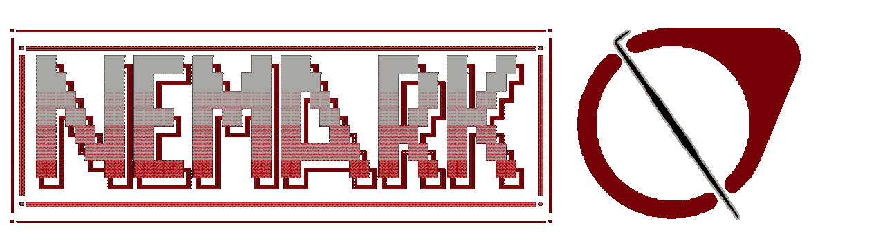

<h1><b>A FREE and Open-Source 3D SDK / Game engine</b></h1>

>[!Important]
> Nemark is not a finished project yet and at the time it is not functional yet!

## Getting the SDK:
- Download the [release](https://github.com/void-ccmdev/nemark/releases) version (precompiled executables).
- Download from source - (non-compiled source code from [here](https://github.com/void-ccmdev/nemark/releases) )
    - Download using git
        ```bash
            git clone https://github.com/void-ccmdev/nemark ./nemark
        ```
    - Download from this page

>[!Warning]
> If you're downloading the source code, you are downloading unfinished bugy code.
> If possible, download the release source code, in order to not install the unfinished one.

## Staring from source: (developers)

 - There are TWO ways of starting from source.
    - [Nix package manager (RECOMMENDED) ](#nix-package-manager)
    - [Manually (Requires you to install dependencies manually) ](#manual-path)

    > [!Important]
    > Nix package manager doesn't work on Windows!
    > If you are using windows, use the [manual path](#manual-path) or use the [Windows subsystem for Linux](https://learn.microsoft.com/en-us/windows/wsl/).
 

 - ### Nix Package manager
To get started, you need to have ```nix``` and ```git``` on you computer.

Nix will handle all the dependencies of Nemark SDK source code, as it is a package manager.

To intstall Nix, follow the simple steps on [THE NIX DOWNLOAD PAGE](https://nixos.org/download#download-nix) for your desired usecase.

After installing Nix, you need to enable experimental features ```nix-command``` and ```flakes```by going into ```etc/nix/nix.conf``` and adding ```experimental-features = nix-command flakes```to the configuration file OR if you are using [NixOS](https://nixos.org/), add ```nix.settingsexperimental-features = [ "nix-command" "flakes" ];``` to your ```/etc/nixos/configuration.nix```
Adding to ```/etc/nix/nix.conf``` :
```bash
    experimental-features = nix-command flakes
```
Or alternatively you can add this to your ```/etc/nixos/configuration.nix```, if using [NixOS](https://nixos.org/)
```bash
    nix.settings.experimental-features = [ "nix-command" "flakes" ];
```
You are now able to use ```nix-command``` and ```flakes```, therefore you are ready to build andrun after you enter the nix developer shell for Nemark SDK.
To enter the Developer shell enter this into your terminal, after cd-ing into the Nemark folder:
```bash
    nix develop
```
After running this command, nix will gather all the necessary packages for the Nemark SDK sourcecode, as there is a ```flake.nix``` file included in the ```nemark``` folder.

 - ### Manual path
If not using ```Nix package manager```, you can always set up your dependencies manually.
In order to be able to build the ```Nemark SDK source code```, you will need to have it'sdependencies installed on your computer.
- [<b>CMake</b>](https://cmake.org/)
- <b>A C/C++ compiler (MSVC, GCC, CLANG)</b>
    - [<b>MSVC</b> (Windows)](https://learn.microsoft.com/en-us/cpp/overview/acquire-msvc?view=msvc-170)
    - [<b>GCC</b> (Linux / Windows / BSD / MacOS)](https://gcc.gnu.org/) 
    - [<b>CLANG</b> (Linux / Windows / BSD / MacOS)](https://clang.llvm.org/)
- [<b>GLFW</b> (Nemark supplies GLFW for Windows due to Windows not supplying it.)](https://wwwglfw.org/)
This should be enough for most systems and if you encounter any problems with the dependencies,feel free to ask on [discord](https://discord.gg/ScdbabjY9K) about fixing them.

## Building and Running from source: (developers):
Building and Running from source is very easy thanks to ```CMake```.

In order to build, make sure you are located in the ```nemark``` folder.

> [!Note]
> If you are using the ```nix``` package manager, make sure to be in ```nix develop shell``` by running this in the ```nemark``` folder:
>```bash
>    nix develop
>```
### Initializing build:
```bash
    cmake -S build
```
### Building:
```bash
    cmake --build build
```
### Running:
GCC / CLANG:
```bash
./build/<executable-name> 
```
MSVC:
```bash
    .\build\Debug\<executable-name>
```
You may experience some compile warning, yet they aren't affecting the final build.